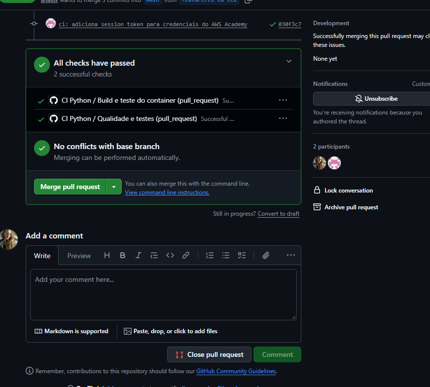
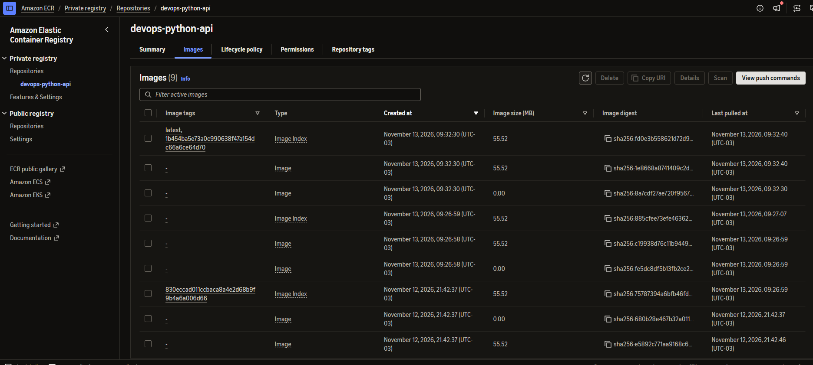
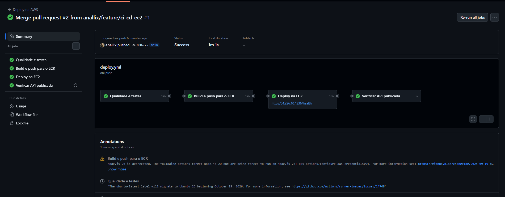
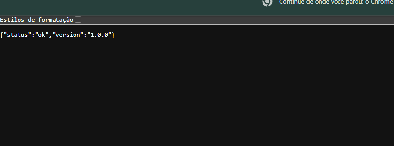
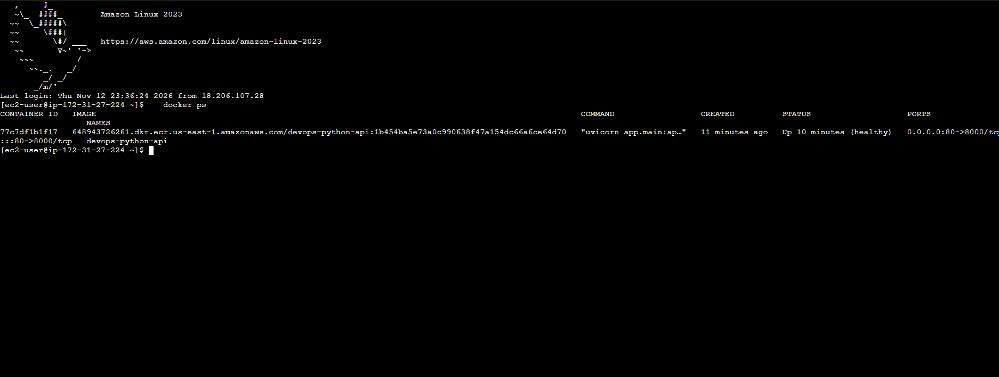
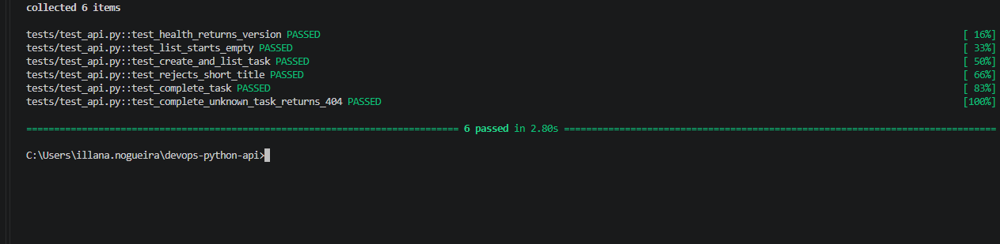
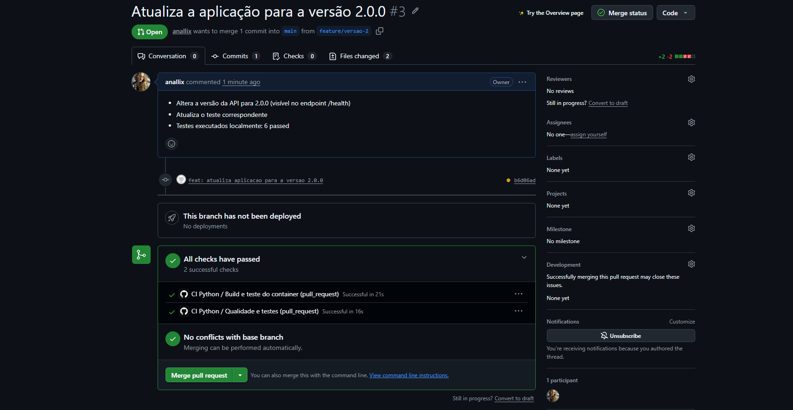
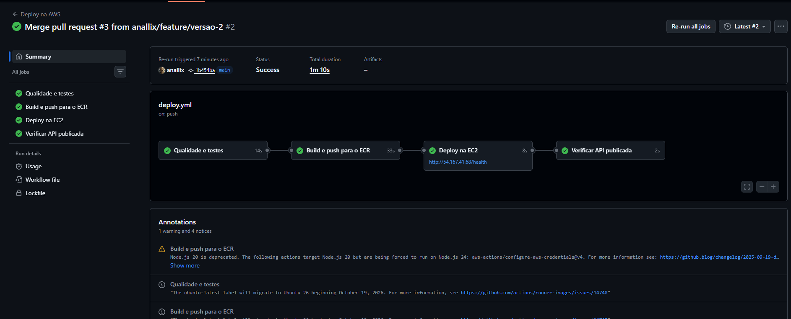
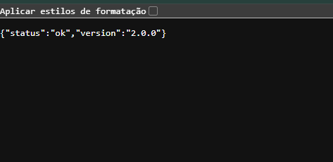

# devops-python-api

Trabalho Final da disciplina **Integração DevOps**.

## Descrição da aplicação

API REST de tarefas escrita em Python com FastAPI. Ela permite criar, listar e concluir tarefas, e tem um endpoint de saúde (`/health`) que informa a versão em execução.

O objetivo do trabalho é implementar uma esteira de CI/CD completa: toda alteração passa por Pull Request e por testes automatizados e, depois do merge na `main`, é empacotada em Docker, publicada no Amazon ECR e implantada automaticamente em uma instância Amazon EC2.

## Execução local

Pré-requisitos: Git e Python 3.12 ou superior.

```bash
git clone https://github.com/anallix/devops-python-api.git
cd devops-python-api
python -m pip install -r requirements-dev.txt

# executar os testes
python -m pytest -v

# subir a API em http://localhost:8000
python -m uvicorn app.main:app --reload
```

## Docker

```bash
# construir a imagem
docker build -t devops-python-api:local .

# executar o container
docker run -d --name devops-python-api -p 8000:8000 devops-python-api:local

# testar
curl http://localhost:8000/health
```

## Pipeline de entrega contínua (`.github/workflows/deploy.yml`)

Executa automaticamente a cada atualização da `main` (merge de Pull Request). São quatro jobs encadeados: se um falhar, os seguintes não rodam, então nada é publicado ou implantado sem os testes passarem.

> No Learner Lab, as credenciais expiram ao fim de cada sessão e o IP público da EC2 muda quando a instância é reiniciada. A cada nova sessão, é preciso atualizar os três secrets `AWS_*` e a variável `EC2_HOST`.

## URL da API publicada

- <http://54.167.41.68/health>
- <http://54.167.41.68/docs>

## Como verificar a versão implantada

```bash
curl http://54.167.41.68/health
# {"status":"ok","version":"2.0.0"}
```

```bash
docker ps --format "{{.Image}}"
# 648943726261.dkr.ecr.us-east-1.amazonaws.com/devops-python-api:1b454ba5e73a0c990638f47a154dc66a6ce64d70
```

## Pull Requests

- [#2: Implementa esteira CI/CD com Docker, ECR e EC2](https://github.com/anallix/devops-python-api/pull/2), primeiro deploy (versão 1.0.0)
- [#3: Atualiza a aplicação para a versão 2.0.0](https://github.com/anallix/devops-python-api/pull/3), atualização automática (versão 2.0.0)

## Evidências

### Integração contínua: testes no Pull Request



### Imagens publicadas no Amazon ECR com a tag do commit



### Primeiro deploy (versão 1.0.0)





### Container em execução na EC2



### Atualização automática (versão 2.0.0)

Testes executados localmente:



Testes automáticos no PR #3:



Deploy automático após o merge:



API atualizada:

